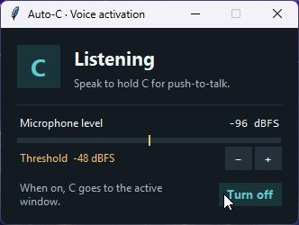

# Auto-C

Auto-C listens to your microphone on Windows and holds **C** while you speak. A button on the second-monitor display lets you enable voice activation in the League lobby, in a match, or in another app. Audio is processed locally.



## Play

1. On Windows 10 or 11, install Python 3 with the Windows Python launcher (`py`) and Tkinter. Download the repository using **Code → Download ZIP**, extract it, and open the folder. Python 3.10 x64 was used for testing.
2. In League, enable **Team Voice** and confirm its push-to-talk binding is **C**. Riot preserves bindings you previously customized. [Patch 26.23 notes](https://www.leagueoflegends.com/en-us/news/game-updates/league-of-legends-patch-26-23-notes/)
3. Double-click **Auto-C.cmd**. On first launch it installs the dependencies. The always-on-top mini display opens in the upper-right corner of your second monitor, or on the main monitor when only one is connected. Drag its title bar to move it.
4. Auto-C starts **Off**. Click **Turn on**, then use the lobby, game, or app where you want C to go. The **C** indicator turns green after two consecutive 20 ms speech frames and the key releases after 300 ms of quiet.
5. Click **Turn off** to release C and pause keypresses. The microphone meter stays live so you can tune the threshold. Closing the panel also releases C and stops the microphone.

While On, speech sends C to whichever window is active, including text fields. Turn it off when you want to type. To use it with friends in the regular lobby, set **Party Voice** to push-to-talk and bind its key to **C**. **Team Voice** becomes available in champion select. [League voice settings](https://support.riotgames.com/en-us/league-of-legends/gameplay/league-voice)

## Tune the microphone

Double-click **Test microphone.cmd**. Speak normally, then pause. The purple **MIC** indicator shows when the detector hears speech. The meter shows the microphone level and the gold marker shows the threshold. Test mode sends no keys.

Use **−** to pick up quieter speech or **+** to require a louder voice. Each click moves the gold marker by **1 dB** and changes the active window's trigger immediately. Both the live and test windows remember your last adjustment for the next launch.

The initial threshold is **−45 dBFS**. To start a session at a specific value, pass `--threshold` from PowerShell.

```powershell
.\Auto-C.cmd --display --dry-run --threshold -55
.\Auto-C.cmd --display --threshold -55
```

Auto-C starts with the Windows default input. To use the microphone selected in League, run `.\Auto-C.cmd --list-devices`, then pass its numeric ID with `--device ID` in either mode. To run a console microphone test, use `.\Auto-C.cmd --dry-run` and press **Ctrl+C** to stop.

## Existing project

Auto-C imports Google's WebRTC voice activity detector through the Windows wheel from **py-webrtcvad-wheels**. Its speech classification and the adjustable volume threshold must both pass. Microphone capture uses **python-sounddevice**. [WebRTC detector wrapper](https://github.com/daanzu/py-webrtcvad-wheels) · [python-sounddevice](https://github.com/spatialaudio/python-sounddevice)
